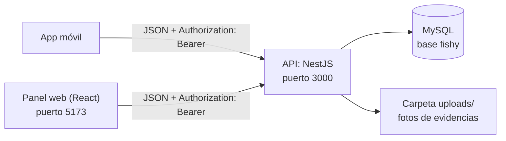
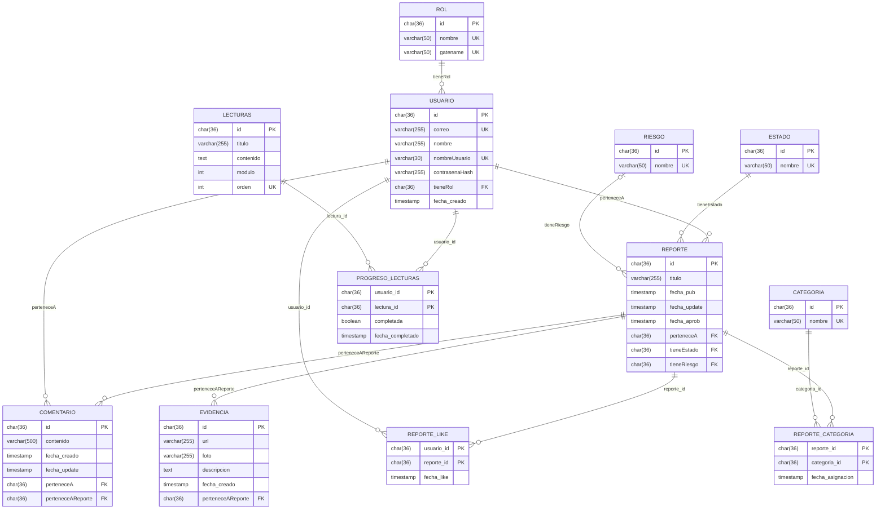
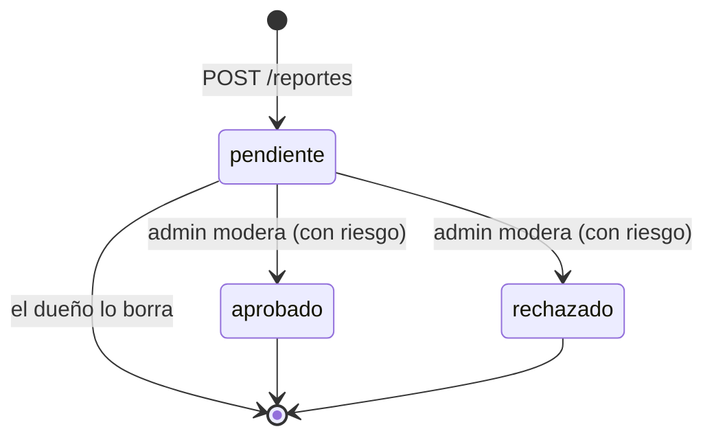
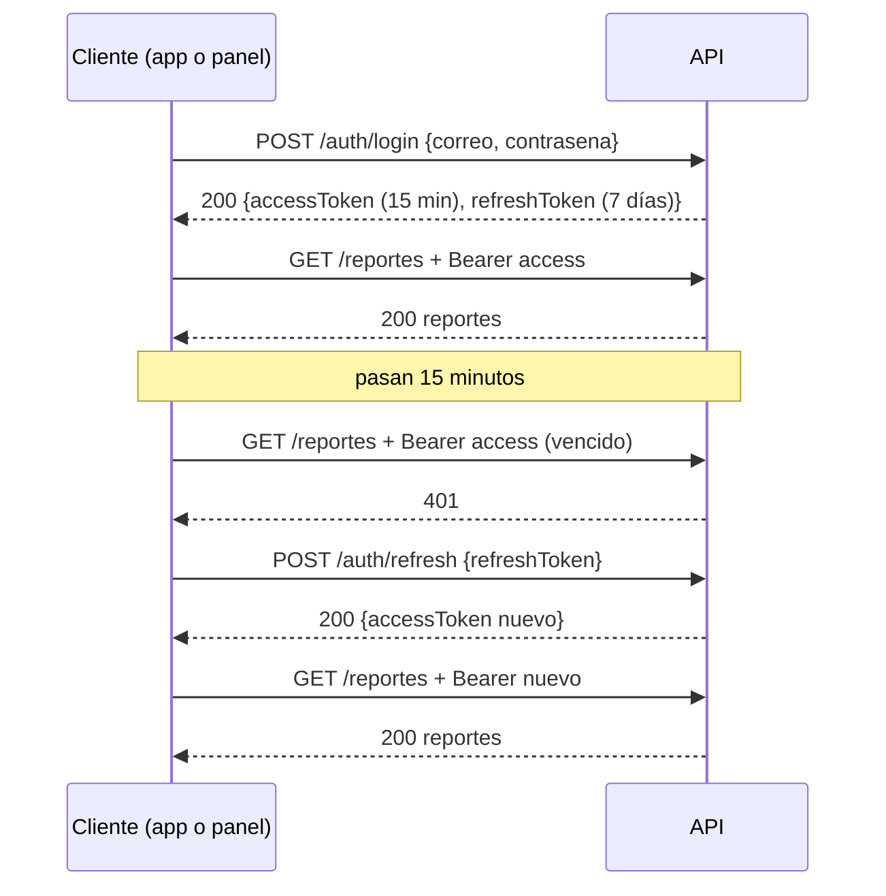

# Documento técnico — Fishy · API (backend)

> Los diagramas están en **Mermaid**: se ven en la vista previa de VS Code
> (`Cmd/Ctrl + Shift + V`, con la extensión *Markdown Preview Mermaid
> Support*) y en GitHub sin instalar nada.
>
> ¿Para quién es? Para otro desarrollador que recibe el proyecto y tiene que
> correrlo, entenderlo y modificarlo sin preguntarle al equipo. Este documento
> cubre solo la API; el panel web tiene su propio README y el manual de usuario
> es otro documento.

**Versión:** 1.0 · **Fecha:** 2026-10-21 · **Equipo:** Luis Enrique Díaz Benítez, Enrique Cruz Salinas, Alani Daniel García Maya, Camila Quintanilla Cabrera

## 1. Resumen

Fishy es una plataforma para reportar fraudes y estafas digitales (SMS falsos,
phishing, ligas falsas, estafas por WhatsApp). Esta API REST en NestJS con
MySQL la consumen la app móvil y el panel web de moderación. Un usuario se
registra, inicia sesión y publica reportes con evidencias (texto y foto); otros
usuarios marcan "me pasó igual" y comentan. Un administrador modera: ningún
reporte aparece en las listas de la comunidad hasta que lo aprueba. También
sirve lecturas educativas con progreso por usuario. Funciona el ciclo completo
(registro, login, reportes, moderación, evidencias, comentarios, likes,
lecturas); los puntos débiles conocidos están en la sección 8.2.

## 2. Arquitectura



- **Clientes** (repositorios aparte): la app móvil y el panel web de
  administración. Ambos consumen la misma API.
- **API** (`backend/`): NestJS. Expone los endpoints, valida con DTOs,
  autentica con JWT, autoriza por rol y guarda en MySQL. Cada módulo sigue la
  misma separación: **controller** (HTTP y guards) → **service** (reglas de
  negocio) → **repository** (SQL con `mysql2`, sin ORM).
- **Base de datos**: MySQL 8, base `fishy`. El pool de conexiones se crea en
  `DatabaseModule` con las variables `DB_*`.
- **Archivos**: las fotos de las evidencias se guardan en disco en `uploads/` y
  se sirven en `/uploads/<archivo>`.

## 3. Tecnologías y versiones

| Capa | Tecnología | Versión | Para qué |
|---|---|---|---|
| Lenguaje | TypeScript | 6.0 | toda la API (modo `strict`) |
| Runtime | Node.js | 20.19+ o 22.12+ | lo que piden las dependencias de NestJS 12 |
| API | NestJS (`common`, `core`, `platform-express`) | 12.0 | módulos, controllers, guards, interceptores |
| Validación | class-validator + class-transformer | 0.15 / 0.5 | DTOs con `whitelist` y `forbidNonWhitelisted` |
| Base de datos | MySQL | 8.x | persistencia |
| Driver | mysql2 | 3.24 | consultas SQL parametrizadas |
| Contraseñas | bcrypt | 6.0 | hash con sal, costo 10 |
| Subida de archivos | Multer (vía `platform-express`) | — | fotos de evidencias |
| Límite de peticiones | @nestjs/throttler | 6.7 | 100/min global, 5/min en login |
| Cabeceras HTTP | helmet | 8.3 | `nosniff`, CSP, HSTS |
| Configuración | @nestjs/config | 12.0 | lectura de `.env` |
| Documentación API | @nestjs/swagger | 12.0 | OpenAPI en `/docs` |
| Pruebas | Jest + ts-jest | 30.5 / 29.4 | pruebas unitarias de servicios |

El JWT **no** usa librería: se firma y verifica a mano con `node:crypto`
(HS256) en `src/auth/jwt.ts`.

## 4. Instalación y ejecución

### 4.1 Requisitos

- Node.js 20.19 o superior (o 22.12+)
- MySQL 8 corriendo en `localhost:3306`

### 4.2 Base de datos

```bash
cd backend
mysql -u root -p < db/schema.sql         # crea la base `fishy` y sus tablas (no borra datos)
mysql -u root -p fishy < db/seed.sql     # roles, estados, categorías, riesgos y lecturas
```

Sin `db/seed.sql` el registro falla: todo usuario nuevo recibe el rol
`usuario`, y ese rol sale del seed. Corre el seed **una sola vez**: las
lecturas se insertan con `INSERT` normal y `orden` es único, así que repetirlo
da error por duplicados (los catálogos usan `INSERT IGNORE` y no fallan).

### 4.3 API

```bash
cd backend
npm install
cp .env.template .env     # y llena los valores
npm run start:dev         # http://localhost:3000, Swagger en /docs
```

Otros comandos:

```bash
npm run build             # compila a dist/
npm run start:prod        # node dist/main
npx jest                  # pruebas unitarias (no hay script "test" en package.json)
```

Variables de entorno (`.env`):

| Variable | Ejemplo | Para qué |
|---|---|---|
| `DB_HOST` | `localhost` | servidor MySQL |
| `DB_PORT` | `3306` | puerto de MySQL |
| `DB_NAME` | `fishy` | nombre de la base (obligatoria) |
| `DB_USER` | `usuario_local` | usuario de MySQL (obligatoria) |
| `DB_PASSWORD` | `[contraseña de MySQL]` | contraseña de MySQL |
| `JWT_SECRET` | `[cadena larga aleatoria]` | firmar los tokens; sin ella la API falla al firmar. Genérala con `openssl rand -base64 48` |
| `FRONT_URL` | `http://localhost:5173` | único origen permitido por CORS |

El puerto está escrito en `src/main.ts` (`3000`); no se lee de una variable de
entorno. El servidor escucha en `0.0.0.0` e imprime al arrancar la IP de la red
local (`http://192.168.x.x:3000`), que es la que usa la app del celular.

### 4.4 Hacer admin a un usuario

No hay ruta para eso. Registra al usuario y cámbiale el rol en MySQL:

```sql
UPDATE usuario SET tieneRol = (SELECT id FROM rol WHERE nombre = 'admin')
WHERE correo = 'ana@example.com';
```

Después vuelve a iniciar sesión: el rol viaja dentro del token y el token viejo
sigue diciendo `usuario`.

## 5. Modelo de datos



- Los ids son UUID (`CHAR(36)`) generados en la API.
- `contrasenaHash` guarda bcrypt, nunca la contraseña. `evidencia.foto` es el
  **nombre del archivo** en `uploads/` (la API responde `/uploads/<nombre>`; si
  aún no hay foto responde solo `/uploads/`).
- Si se borra un usuario, sus reportes y comentarios **se conservan** con
  `perteneceA = NULL` (`ON DELETE SET NULL`) y la API muestra al autor como
  "Usuario eliminado". Sus likes y su progreso de lecturas sí se borran.
- Si se borra un reporte, la base borra en cascada sus evidencias, comentarios,
  likes y categorías; la API además borra del disco las fotos.
- Los catálogos que carga `db/seed.sql`: roles `admin` y `usuario`; estados
  `pendiente`, `aprobado` y `rechazado`; riesgos `Alto`, `Bajo` y `Medio`;
  categorías `Recientes`, `SMS`, `URL`, `Email` y `Otros`; y 4 lecturas.

### Ciclo de vida de un reporte



- Mientras está `pendiente`, solo su dueño lo edita o lo borra.
- Ya moderado (`aprobado` o `rechazado`) queda **congelado**: la API responde
  400 a cualquier intento de editarlo, borrarlo o moderarlo de nuevo.
- Al aprobar se guarda `fecha_aprob`.
- En las listas, un usuario normal solo ve reportes `aprobado`; sus propios
  pendientes solo los ve pidiéndolos por id.

## 6. API

Documentación completa e interactiva en **<http://localhost:3000/docs>**
(OpenAPI/Swagger); el documento crudo está en `/docs-json`. Resumen:

Las rutas con **Bearer** requieren `Authorization: Bearer <accessToken>` y sin
él responden 401. Las marcadas **admin** además responden 403 a un usuario
normal. **dueño** significa que solo el autor del reporte puede hacerlo.

### Auth

| Método | Ruta | Auth | Qué hace |
|---|---|---|---|
| POST | `/auth/register` | no | crea usuario con rol `usuario` (`nombre`, `correo`, `nombreUsuario`, `contrasena` de 8+) |
| POST | `/auth/login` | no | regresa `accessToken` (15 min) y `refreshToken` (7 días); máximo 5 intentos por minuto |
| POST | `/auth/refresh` | no | regresa un `accessToken` nuevo (solo el access; el refresh no cambia) |
| GET | `/auth/me` | Bearer | `id`, `nombre`, `nombreUsuario`, `correo` y `rol` |

### Reportes

| Método | Ruta | Auth | Qué hace |
|---|---|---|---|
| GET | `/reportes` | Bearer | admin: todos; usuario: solo los aprobados |
| POST | `/reportes` | Bearer | crea un reporte `pendiente` (`titulo`, `categorias`: ids, al menos una) |
| GET | `/reportes/pendientes` | admin | cola de moderación |
| GET | `/reportes/mios` | Bearer | tus reportes con su estado, total y aportes |
| GET | `/reportes/estadisticas` | Bearer | aprobados por categoría en los últimos 30 días |
| GET | `/reportes/:id` | Bearer | admin y dueño: cualquiera; los demás: solo aprobados (si no, 404) |
| PATCH | `/reportes/:id` | dueño | edita título, categorías, descripción o enlace mientras está pendiente |
| PATCH | `/reportes/:id/moderar` | admin | aprueba o rechaza (`tieneEstado`, `tieneRiesgo`) |
| POST | `/reportes/:id/like` | Bearer | marca "me pasó igual" (no en tu propio reporte) |
| DELETE | `/reportes/:id/like` | Bearer | quita el "me pasó igual" |
| DELETE | `/reportes/:id` | dueño | borra un reporte pendiente y sus fotos (204) |

### Evidencias

| Método | Ruta | Auth | Qué hace |
|---|---|---|---|
| GET | `/evidencias` | Bearer | admin: todas; usuario: solo de reportes aprobados |
| POST | `/evidencias` | dueño | agrega evidencia (`perteneceAReporte`, `url`, `descripcion`) |
| GET | `/evidencias/consultar-enlace?url=` | Bearer | busca una evidencia aprobada con ese enlace |
| GET | `/evidencias/:id` | Bearer | una evidencia |
| PATCH | `/evidencias/:id` | dueño | edita `url` o `descripcion` |
| POST | `/evidencias/:id/photo` | dueño | sube o reemplaza la foto (`multipart/form-data`, campo `photo`) |
| DELETE | `/evidencias/:id` | dueño | borra la evidencia y su foto (204) |

### Comentarios

| Método | Ruta | Auth | Qué hace |
|---|---|---|---|
| GET | `/reportes/:reporteId/comentarios` | Bearer | comentarios de un reporte que puedas ver |
| POST | `/reportes/:reporteId/comentarios` | Bearer | comenta (`contenido`, máx. 500) |
| PATCH | `/reportes/:reporteId/comentarios/:id` | autor | edita su comentario (ni un admin edita ajenos) |
| DELETE | `/reportes/:reporteId/comentarios/:id` | autor o admin | borra el comentario (204) |

### Usuarios

| Método | Ruta | Auth | Qué hace |
|---|---|---|---|
| GET | `/usuarios` | admin | lista usuarios |
| POST | `/usuarios` | admin | crea un usuario con rol `usuario` (contraseña de 10 a 72) |
| GET | `/usuarios/me` | Bearer | tu usuario |
| PATCH | `/usuarios/me` | Bearer | edita tu nombre, correo o contraseña |
| GET | `/usuarios/:id` | Bearer | tu usuario (admin: cualquiera; otro id responde 404) |
| PATCH | `/usuarios/:id` | Bearer | igual que `GET`: el tuyo (admin: cualquiera) |
| DELETE | `/usuarios/:id` | admin | borra un usuario (204); 409 si tiene registros asociados |

### Lecturas

| Método | Ruta | Auth | Qué hace |
|---|---|---|---|
| GET | `/lecturas` | Bearer | lista con tu progreso; filtro opcional `?modulo=` |
| GET | `/lecturas/progreso` | Bearer | `completadas`, `total` y `porcentaje` |
| GET | `/lecturas/:id` | Bearer | una lectura |
| POST | `/lecturas/:id/completar` | Bearer | la marca como completada |
| DELETE | `/lecturas/:id/completar` | Bearer | quita la marca |
| POST | `/lecturas` | admin | crea una lectura (`titulo`, `contenido`, `modulo`, `orden` opcional) |
| PATCH | `/lecturas/:id` | admin | edita una lectura |
| DELETE | `/lecturas/:id` | admin | borra una lectura (204) |

### Catálogos

| Método | Ruta | Auth | Qué hace |
|---|---|---|---|
| GET | `/estados`, `/estados/:id` | Bearer | estados (solo lectura) |
| GET | `/riesgos`, `/riesgos/:id` | Bearer | niveles de riesgo (solo lectura) |
| GET | `/categorias`, `/categorias/:id` | Bearer | categorías |
| POST / PATCH / DELETE | `/categorias`, `/categorias/:id` | admin | alta, edición y baja de categorías |
| GET | `/roles` | admin | lista roles |
| GET | `/roles/:id` | Bearer | un rol |
| POST / PATCH / DELETE | `/roles`, `/roles/:id` | admin | alta, edición y baja de roles |

Errores: `{ statusCode, message, error }`. `message` puede ser arreglo cuando
falla la validación del DTO. Un campo que no está en el DTO responde 400
(`forbidNonWhitelisted`). Un recurso ajeno responde 404, igual que uno
inexistente.

## 7. Autenticación



- Tokens JWT firmados con HMAC-SHA256 y `JWT_SECRET`, construidos a mano en
  `src/auth/jwt.ts`. La firma se compara con `timingSafeEqual`.
- El payload lleva `sub` (id del usuario), `correo`, `tieneRol`, `rolNombre`,
  `type` (`access` o `refresh`), `iat` y `exp`. Un refresh token no sirve para
  pedir recursos y un access token no sirve para refrescar.
- `AuthGuard` (a nivel de controller) valida el Bearer y deja el payload en
  `req.user`. `RolesGuard` + `@Roles('admin')` protege las rutas de admin y
  **vuelve a consultar el rol en la base** en cada petición, no confía en
  `rolNombre` del token.
- Las reglas de negocio de los reportes y comentarios sí usan `rolNombre` del
  token; si cambias el rol de alguien en MySQL, su token viejo dice el rol
  anterior hasta que vence (15 min el access).
- Solo el login emite el `refreshToken`; `/auth/refresh` regresa únicamente un
  `accessToken` nuevo y el refresh sigue siendo el mismo.

## 8. Seguridad

### 8.1 Decisiones tomadas

| Tema | Decisión | Por qué |
|---|---|---|
| Inyección SQL | consultas con parámetros `?`; las columnas dinámicas se filtran con lista blanca | el valor nunca se interpreta como SQL |
| Contraseñas | bcrypt con 10 rondas; nunca se guarda en claro | si se filtra la base, no se filtran contraseñas |
| Sesión | JWT access corto (15 min) + refresh largo (7 días) | un access robado sirve poco; el usuario no escribe su contraseña cada rato |
| Secretos | `JWT_SECRET` y datos de MySQL en `.env`, fuera del repositorio; la API falla si falta `JWT_SECRET` | no publicar llaves ni firmar con un valor por defecto |
| Autorización | guards en la API; la consulta del dueño exige `WHERE id = ? AND perteneceA = ?` | el cliente no decide quién ve qué |
| Recurso ajeno | responde **404**, igual que uno inexistente | un 403 confirmaría que el id existe |
| Login | un solo mensaje ("Credenciales inválidas") y se calcula el hash aunque el correo no exista | evitar enumerar qué correos tienen cuenta |
| Fuerza bruta | `@nestjs/throttler`: 5 intentos de login por minuto por IP (429) y 100 por minuto global | limitar el adivinar contraseñas |
| Validación | DTOs con class-validator, `whitelist: true` y `forbidNonWhitelisted: true` | lo que no está en el DTO se rechaza con 400 |
| Archivos | solo png, jpg, jpeg y webp (mimetype **y** extensión), máximo 5 MB, nombre `UUID + extensión` | evitar subir HTML o scripts y que se sobrescriban o adivinen archivos |
| Dueño de la foto | solo el dueño del reporte sube, cambia o borra la foto | evitar que otro usuario cambie la foto de un reporte ajeno |
| CORS | solo el origen de `FRONT_URL` | otra página no puede usar la API desde el navegador |
| Cabeceras | `helmet` (incluye `X-Content-Type-Options: nosniff`) con `cross-origin` para las fotos | segunda capa contra archivos disfrazados; el front en otro puerto debe poder mostrar las fotos |
| Logs | `Logger` de Nest registra eventos (por ejemplo, un login), nunca tokens | un token en los logs es una sesión válida |
| Errores | excepciones de Nest con mensaje claro; los errores de configuración responden un mensaje genérico | no exponer detalles internos con un 500 |
| Moderación | un reporte moderado queda congelado | decisiones consistentes y trazables |
| Borrado de usuarios | `ON DELETE SET NULL` en reportes y comentarios | no perder el contenido ya moderado |

### 8.2 Riesgos conocidos

Lo que **sabemos** que falta o es débil, para que quien reciba el proyecto no
lo descubra a golpes:

| # | Riesgo | Dónde | Impacto | Qué haría falta |
|---|---|---|---|---|
| 1 | Cerrar sesión no invalida tokens en el servidor y el refresh no rota | API | un refresh copiado sirve hasta 7 días | tabla de refresh tokens con revocación, `POST /auth/logout` y rotación |
| 2 | Access y refresh se firman con el mismo secreto y el JWT está hecho a mano | `src/auth/jwt.ts` | si se filtra el secreto, se comprometen ambos; los detalles criptográficos son fáciles de equivocar | secretos separados o `@nestjs/jwt` |
| 3 | Sin HTTPS; la API escucha en `0.0.0.0` | `src/main.ts` | tráfico legible en la red local | TLS en el despliegue y escuchar solo donde haga falta |
| 4 | `/uploads` es público | `src/main.ts` | quien tenga el enlace ve la foto (el UUID no se adivina) | servir las fotos por un endpoint con guard |
| 5 | `/auth/register` responde 409 si el correo o el usuario ya existen | `auth.service.ts` | permite saber si un correo tiene cuenta | responder igual y confirmar por correo |
| 6 | Un admin puede borrar su propia cuenta o a otro admin; el único freno es la interfaz del panel | `usuario.controller.ts` | quedarse sin administradores | validar en la API que no se borre a sí mismo ni al último admin |
| 7 | El cambio de rol no se refleja en el token hasta que vence | `jwt.ts`, servicios de reporte y comentario | el token dice el rol viejo hasta 15 min | consultar el rol en cada petición también en los servicios |
| 8 | `GET /reportes/estadisticas` y `GET /roles/:id` no exigen rol admin | `reporte.controller.ts`, `rol.controller.ts` | cualquier usuario con sesión los consulta | decidir si deben ser solo admin |
| 9 | Contraseña mínima distinta: 8 caracteres al registrarse y 10 al crear o editar desde `/usuarios` | `register.dto.ts`, `create-usuario.dto.ts` | política inconsistente | unificar la regla |
| 10 | El archivo `.env` local trae datos reales de MySQL; hoy está fuera de git, pero viaja si se comprime la carpeta | `backend/.env` | filtrar la contraseña de la base al compartir el zip | no incluir `.env` al entregar y rotar la contraseña si ya se compartió |

## 9. Estructura de carpetas

```
Fishy_backend/
├── docs/                  # documento técnico del sistema completo y manual de usuario
└── backend/
    ├── src/
    │   ├── auth/          # register, login, refresh, jwt.ts, AuthGuard, RolesGuard
    │   ├── usuario/       # controller, service, repository, DTOs
    │   ├── reporte/       # reportes, categorías del reporte, likes, estadísticas
    │   ├── evidencia/     # evidencias y subida de fotos
    │   ├── comentario/    # comentarios de reportes
    │   ├── lecturas/      # lecturas educativas y progreso
    │   ├── categoria/  estado/  riesgo/  rol/   # catálogos
    │   ├── database/      # pool de MySQL (mysql2)
    │   ├── app.module.ts  # ConfigModule, ThrottlerModule y módulos
    │   └── main.ts        # CORS, helmet, ValidationPipe, Swagger, /uploads
    ├── db/
    │   ├── schema.sql     # tablas
    │   └── seed.sql       # catálogos y lecturas
    ├── uploads/           # fotos (fuera de git)
    ├── .env.template      # plantilla de variables
    ├── jest.config.js
    ├── nest-cli.json
    ├── tsconfig.json
    └── package.json
```

Cada módulo trae sus `dto/`, y los que tienen tabla propia también `entities/`.
Hay pruebas unitarias en `auth.service.spec.ts`, `reporte.service.spec.ts` y
`evidencia.service.spec.ts`.

## 10. Pendientes y mejoras

- [ ] **Alinear el panel con la API:** el panel web manda `{ titulo, contenido, orden }` a `POST /lecturas`, pero la API exige además `modulo` (entero ≥ 1) y rechaza campos desconocidos; hoy crear una lectura desde el panel responde 400. Falta agregar `modulo` al formulario del panel o hacerlo opcional con valor por defecto en el DTO.
- [ ] Riesgo 1 de la sección 8.2: tabla de refresh tokens, `POST /auth/logout` y rotación del refresh.
- [ ] Riesgo 2: separar los secretos o usar `@nestjs/jwt` en lugar de la implementación propia.
- [ ] Riesgo 6: impedir en la API que un admin borre su propia cuenta o al último admin.
- [ ] Servir las fotos por un endpoint protegido (riesgo 4).
- [ ] Leer el puerto desde una variable de entorno (`PORT`) en lugar de dejar `3000` en `main.ts`.
- [ ] Agregar el script `"test": "jest"` a `package.json` y ampliar las pruebas (hoy cubren auth, reportes y evidencias; faltan comentarios, lecturas y usuarios).
- [ ] Actualizar `backend/README.md`: su tabla de configuración dice que las llaves están escritas en el código y que `.env` no cambia nada, y hoy ya no es cierto.
- [ ] Hacer repetible `db/seed.sql` (usar `INSERT IGNORE` o `ON DUPLICATE KEY` en las lecturas).
- [ ] Configurar ESLint y Prettier en el backend.
- [ ] Despliegue con HTTPS.
