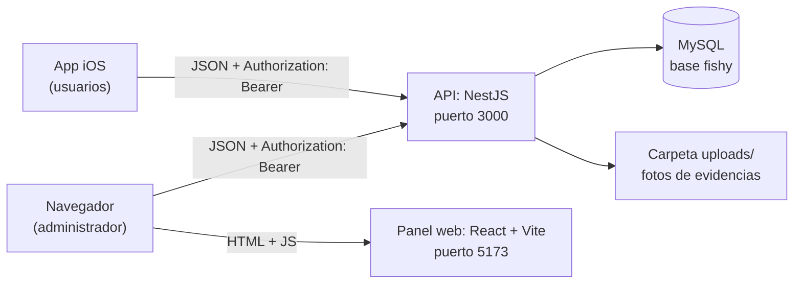
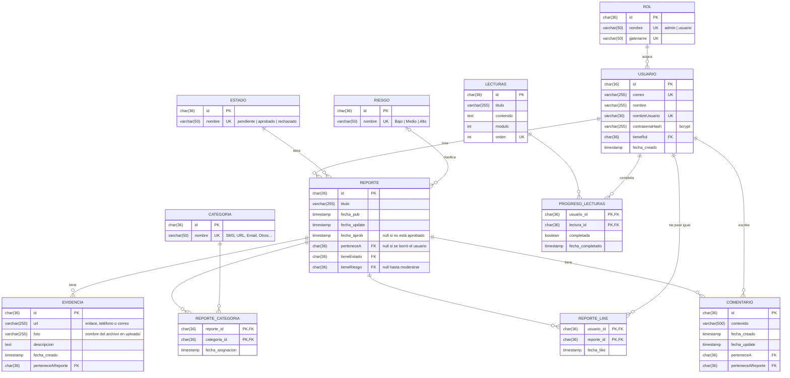
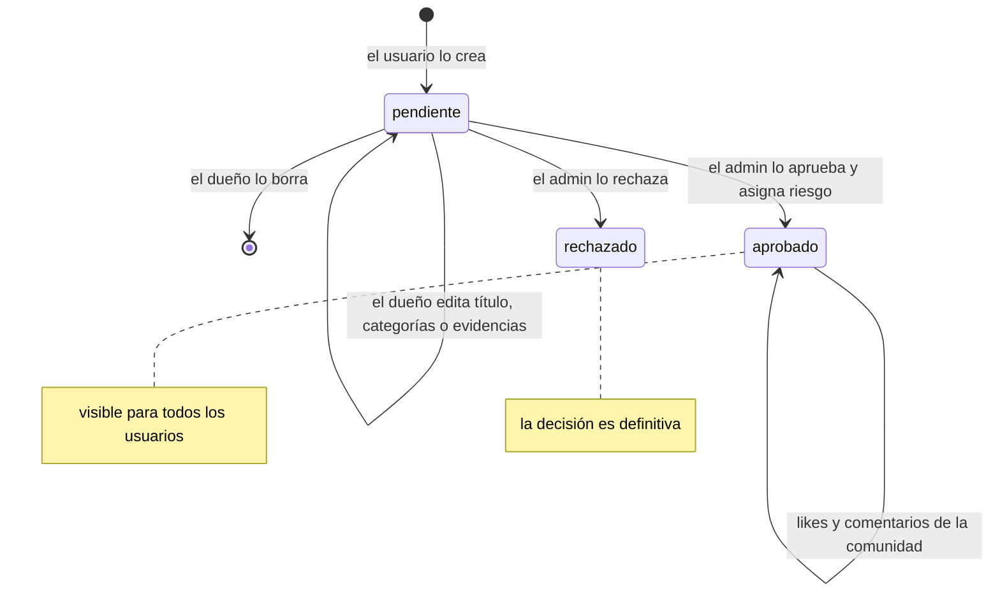
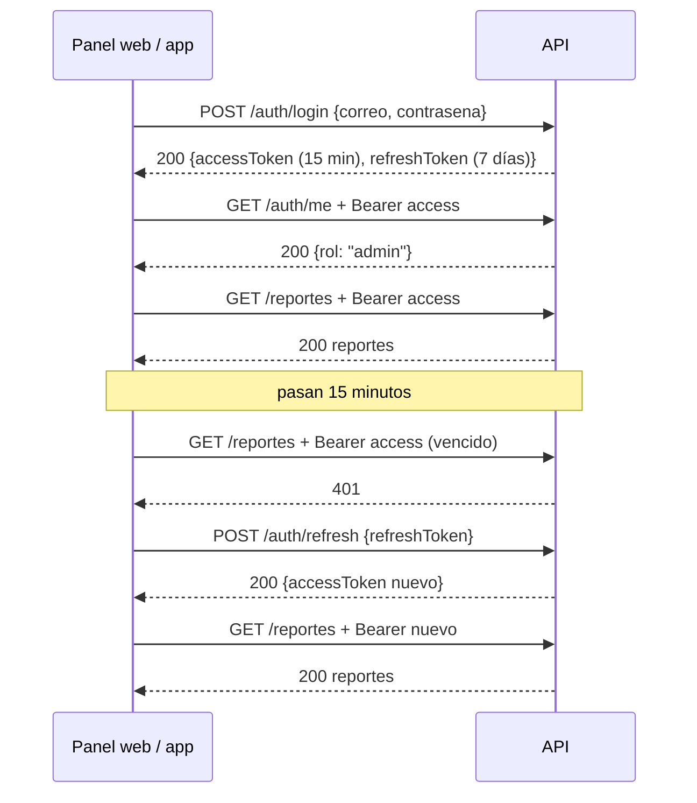

# Documento técnico — Fishy

**Versión:** 1.0 · **Fecha:** 2026-10-20
**Equipo 3**

- Luis Enrique Díaz Benítez — A01668493
- Enrique Cruz Salinas — A01668489 
- Alani Daniel García Maya — A01277308
- Camila Quintanilla Cabrera — A01662397 

## 1. Resumen

Fishy es una plataforma para reportar fraudes y estafas digitales (SMS falsos,
phishing, estafas por WhatsApp, páginas falsas). Los usuarios reportan desde una
**app de iOS**; un administrador modera cada reporte desde un **panel web** y solo
los reportes aprobados se publican para la comunidad. El sistema tiene tres
partes: una **API REST en NestJS** con MySQL, el **panel web de administración en
React** y la **app de iOS**, que consume la misma API.

Estado: funcionan el registro e inicio de sesión con roles, el ciclo completo de
los reportes (crear → moderar → publicar), evidencias con foto, "me pasó igual",
comentarios, lecturas educativas con progreso y el dashboard del administrador.
Se corrigieron las vulnerabilidades encontradas con SonarQube, `npm audit` y
revisión manual; los riesgos que quedan están en la sección 8.2.

## 2. Arquitectura



- **Panel web** (`Fishy_frontend/frontend`): aplicación de React compilada con
  Vite. Desde el navegador llama directo a la API con `fetch`
  (`src/api/client.js`).
- **API** (`backend`): NestJS. Expone los endpoints, valida con DTOs,
  autentica con JWT, controla roles y guarda en MySQL.
- **App iOS**: cliente para los usuarios finales. Usa los mismos endpoints;
  la API escucha en `0.0.0.0` para que el celular la alcance por la red local.
- **Base de datos**: MySQL 8, base `fishy`.
- **Archivos**: las fotos de evidencias se guardan en disco en `backend/uploads/`
  y se sirven en `/uploads/<archivo>`.

## 3. Tecnologías y versiones

| Capa | Tecnología | Versión | Para qué |
|---|---|---|---|
| Lenguaje | TypeScript | 6.0 | API |
| Runtime | Node.js | 22.x (mínimo 22.22) | ejecutar API y panel |
| API | NestJS | 12.1 | módulos, controllers, DTOs, guards |
| Validación | class-validator | 0.15 | reglas de los DTOs |
| Base de datos | MySQL | 8.x | persistencia |
| Driver | mysql2 | 3.24 | consultas SQL parametrizadas |
| Contraseñas | bcrypt | 6.0 | hash con sal |
| Límite de peticiones | @nestjs/throttler | 6.7 | máximo 5 logins por minuto |
| Encabezados de seguridad | helmet | 8.3 | nosniff, HSTS, CSP, etc. |
| Subida de archivos | multer | 2.4 | fotos de evidencias |
| Documentación API | @nestjs/swagger | 12.0 | OpenAPI en `/docs` |
| Pruebas | Jest | 30.5 | pruebas unitarias de servicios |
| Panel web | React | 19.3 | interfaz |
| Rutas (panel) | react-router-dom | 7.18 | navegación |
| Compilador (panel) | Vite | 8.3 | servidor de desarrollo y build |
| Gráficas | Recharts | 3.10 | dashboard |
| Íconos | lucide-react | 1.53 | íconos |
| Calidad | ESLint + SonarQube Cloud | 10.12 | lint y análisis estático |

## 4. Instalación y ejecución

### 4.1 Requisitos

- Node.js 22.22 o superior
- MySQL 8 corriendo en `localhost:3306`

### 4.2 Base de datos

Desde la carpeta `backend`:

```bash
mysql -u root -p < db/schema.sql          # crea la base fishy y las tablas
mysql -u root -p fishy < db/seed.sql      # roles, estados, categorías, riesgos y lecturas
mysql -u root -p fishy < db/demo_reportes.sql   # opcional: reportes de ejemplo
```

> En PowerShell el `<` no funciona: usar `cmd /c "mysql -u root -p < db\schema.sql"`.

`schema.sql` usa `CREATE TABLE IF NOT EXISTS`: volver a correrlo crea las tablas
que falten sin borrar datos, pero **no modifica** tablas existentes. Si cambia la
estructura de una tabla, hay que borrar la base y crearla de nuevo.

**Crear el primer administrador.** No hay ruta para hacerse admin: se registra
el usuario (en Swagger, `POST /auth/register`) y se cambia su rol en MySQL:

```sql
UPDATE usuario SET tieneRol = (SELECT id FROM rol WHERE nombre = 'admin')
WHERE correo = 'admin@ejemplo.com';
```

### 4.3 API

```bash
cd backend
npm install
cp .env.template .env     # y llena los valores
npm run start:dev         # http://localhost:3000, Swagger en /docs
```

Variables de entorno (`.env`):

| Variable | Ejemplo | Para qué |
|---|---|---|
| `DB_HOST` | `localhost` | servidor de MySQL |
| `DB_PORT` | `3306` | puerto de MySQL |
| `DB_NAME` | `fishy` | nombre de la base |
| `DB_USER` | `fishy_app` | usuario de MySQL (no usar root) |
| `DB_PASSWORD` | `[contraseña]` | contraseña de MySQL |
| `JWT_SECRET` | `[salida de openssl rand -base64 48]` | firmar los tokens; si falta, la API no firma tokens |
| `FRONT_URL` | `http://localhost:5173` | único origen permitido por CORS |

Usuario de MySQL recomendado para la API (solo los permisos que necesita):

```sql
CREATE USER 'fishy_app'@'localhost' IDENTIFIED BY '[contraseña]';
GRANT SELECT, INSERT, UPDATE, DELETE ON fishy.* TO 'fishy_app'@'localhost';
```

### 4.4 Panel web

```bash
cd Fishy_frontend/frontend
npm install
cp .env.example .env.local   # ajustar VITE_API_URL si la API está en otra máquina
npm run dev                  # http://localhost:5173
```

| Variable | Ejemplo | Para qué |
|---|---|---|
| `VITE_API_URL` | `http://192.168.1.50:3000` | dirección de la API (por defecto `http://localhost:3000`) |

Todo lo que empieza con `VITE_` termina visible en el navegador: nunca poner
secretos ahí.

**En una red local** (otras computadoras abren el panel): correr
`npm run dev -- --host`, poner en `VITE_API_URL` la IP de la máquina de la API y
en `FRONT_URL` del backend la dirección desde la que se abre el panel; si no, CORS
bloquea las peticiones.

### 4.5 Calidad

```bash
cd backend && npx jest            # pruebas unitarias
cd Fishy_frontend/frontend && npm run lint
npm audit                          # en ambos proyectos
```

## 5. Modelo de datos



Decisiones:

- Los ids son **UUID** generados en la API (`randomUUID()`), no autoincrementables:
  no se pueden adivinar ni recorrer.
- `contrasenaHash` guarda **bcrypt** (con sal, costo 10); nunca la contraseña.
- `foto` guarda **solo el nombre** del archivo (`UUID + extensión`); la imagen vive
  en `uploads/`. La API agrega `/uploads/` al responder.
- Borrar un reporte borra en cascada sus evidencias, categorías, likes y
  comentarios. Borrar un usuario deja sus reportes y comentarios con autor `null`
  ("Usuario eliminado").
- Los estados, riesgos, categorías y roles se cargan con `seed.sql`; el código los
  busca por nombre.

### Ciclo de vida de un reporte



## 6. API

Documentación completa e interactiva en **<http://localhost:3000/docs>**
(OpenAPI/Swagger; botón *Authorize* para pegar el token). Resumen:

| Método | Ruta | Auth | Qué hace |
|---|---|---|---|
| POST | `/auth/register` | no | crea usuario con rol `usuario` |
| POST | `/auth/login` | no | regresa `accessToken` y `refreshToken` (máx. 5 intentos/min) |
| POST | `/auth/refresh` | no | regresa un `accessToken` nuevo |
| GET | `/auth/me` | Bearer | datos y rol del usuario logueado |
| GET | `/reportes` | Bearer | admin: todos; usuario: solo aprobados |
| GET | `/reportes/pendientes` | admin | cola de moderación |
| GET | `/reportes/mios` | Bearer | mis reportes y mis estadísticas |
| GET | `/reportes/estadisticas` | Bearer | aprobados por categoría (últimos 30 días) |
| GET | `/reportes/:id` | Bearer | un reporte (ajeno y no aprobado → 404) |
| POST | `/reportes` | Bearer | crea reporte (nace `pendiente`) |
| PATCH | `/reportes/:id` | Bearer | edita reporte propio pendiente |
| DELETE | `/reportes/:id` | Bearer | borra reporte propio pendiente |
| PATCH | `/reportes/:id/moderar` | admin | aprueba o rechaza y asigna riesgo |
| POST / DELETE | `/reportes/:id/like` | Bearer | marca / quita "me pasó igual" |
| GET / POST | `/reportes/:reporteId/comentarios` | Bearer | lista / crea comentario (solo en aprobados) |
| PATCH | `/reportes/:reporteId/comentarios/:id` | Bearer | edita comentario propio |
| DELETE | `/reportes/:reporteId/comentarios/:id` | Bearer | borra comentario propio (admin: cualquiera) |
| GET | `/evidencias` | Bearer | admin: todas; usuario: de reportes aprobados |
| GET | `/evidencias/consultar-enlace?url=` | Bearer | ¿este enlace ya fue reportado y aprobado? |
| GET | `/evidencias/:id` | Bearer | una evidencia |
| POST | `/evidencias` | Bearer | agrega evidencia a un reporte propio |
| PATCH / DELETE | `/evidencias/:id` | Bearer | edita / borra evidencia propia |
| POST | `/evidencias/:id/photo` | Bearer | sube foto (multipart, campo `photo`) |
| GET | `/lecturas`, `/lecturas/progreso`, `/lecturas/:id` | Bearer | lecturas con progreso del usuario |
| POST / DELETE | `/lecturas/:id/completar` | Bearer | marca / desmarca como leída |
| POST / PATCH / DELETE | `/lecturas`, `/lecturas/:id` | admin | administra lecturas |
| GET | `/usuarios` | admin | lista usuarios |
| GET / PATCH | `/usuarios/me` | Bearer | mi perfil |
| GET / PATCH | `/usuarios/:id` | Bearer | el propio (admin: cualquiera) |
| POST / DELETE | `/usuarios`, `/usuarios/:id` | admin | crea / borra usuarios |
| GET | `/categorias`, `/estados`, `/riesgos` (y `/:id`) | Bearer | catálogos |
| POST / PATCH / DELETE | `/categorias`, `/roles` | admin | administra catálogos |
| GET | `/uploads/<archivo>` | no | foto de una evidencia |

Errores: `{ statusCode, message, error }`. `message` puede ser arreglo cuando
falla la validación del DTO. Códigos usados: 400 datos inválidos o campos extra,
401 sin token o token vencido, 403 requiere rol admin, 404 no existe **o no es
tuyo**, 409 duplicado, 429 demasiados intentos de login.

## 7. Autenticación



- Tokens **JWT firmados con HMAC-SHA256** y `JWT_SECRET`, implementados en
  `src/auth/jwt.ts`. La firma se compara con `timingSafeEqual`.
- Cada token lleva `type: 'access'` o `'refresh'`: un refresh no sirve para pedir
  recursos ni un access para refrescar.
- **AuthGuard** valida firma y vencimiento; **RolesGuard** vuelve a consultar el
  rol en la base en cada ruta de admin, así que editar el token no da permisos.
- El panel guarda ambos tokens en `localStorage` (solo si tienen formato JWT) y
  `api()` en `src/api/client.js` hace: Bearer en cada petición → si responde 401,
  refresh → reintento; si el refresh falla, cierra la sesión.
- El panel solo admite administradores: después del login consulta `/auth/me` y,
  si el rol no es `admin`, borra los tokens.

## 8. Seguridad

Se analizó con **SonarQube Cloud** (análisis estático), **npm audit**
(dependencias) y **revisión manual** (lógica de negocio: SonarQube no detecta,
por ejemplo, que un usuario pueda ver datos de otro).

### 8.1 Decisiones tomadas

| Tema | Decisión | Por qué |
|---|---|---|
| Inyección SQL | Todas las consultas con parámetros `?`; columnas dinámicas filtradas por lista blanca (`Set`) | el valor nunca se interpreta como SQL |
| Contraseñas | bcrypt (sal + costo 10); nunca se guarda en claro | si se filtra la base, no se filtran contraseñas |
| Sesión | JWT access corto (15 min) + refresh largo (7 días) | un access robado sirve poco |
| Secretos | `JWT_SECRET` y datos de MySQL en `.env`, fuera del repositorio; la API falla si falta `JWT_SECRET` | no publicar llaves ni firmar con un valor por defecto |
| Autorización | guards en la API; la consulta exige `WHERE id = ? AND perteneceA = ?` | el front no decide quién ve qué |
| Recurso ajeno | responde **404**, igual que uno inexistente | un 403 confirmaría que el id existe |
| Login | un solo mensaje ("Credenciales inválidas") y hash aunque el correo no exista | evitar enumerar qué correos tienen cuenta |
| Fuerza bruta | `@nestjs/throttler`: 5 intentos de login por minuto (429) | limitar adivinar contraseñas |
| Validación | DTOs con class-validator, `whitelist` y `forbidNonWhitelisted` | lo que no está en el DTO se rechaza con 400 |
| Archivos | solo png/jpg/jpeg/webp (mimetype + extensión), máx. 5 MB, nombre `UUID + extensión` | evitar subir HTML/scripts y sobrescribir o adivinar archivos |
| Dueño de la foto | solo el dueño del reporte sube o cambia la foto | antes cualquiera podía cambiar la foto de otro |
| CORS | solo el origen de `FRONT_URL` | otra página no puede usar la API desde el navegador |
| Encabezados | `helmet` (incluye `X-Content-Type-Options: nosniff`) | segunda capa contra archivos disfrazados |
| Logs | sin `console.log`; `Logger` de Nest registra eventos, nunca tokens | un token en los logs es una sesión válida |
| Errores | excepciones de Nest con mensaje claro; sin `throw new Error` genérico | no exponer detalles internos con un 500 |
| Tipos | interfaces para las filas de MySQL en lugar de `any` | el compilador detecta errores |
| Panel web | sin `innerHTML`; enlaces de evidencias se muestran desactivados (`hxxp://…[.]com`) | evitar XSS y que el admin abra un phishing por accidente |
| Dependencias | `npm audit` sin vulnerabilidades en producción (`--omit=dev`) en API y panel | componentes con fallas conocidas |

### 8.2 Riesgos conocidos

Lo que **sabemos** que falta o es débil, para que quien reciba el proyecto no lo
descubra a golpes:

| # | Riesgo | Dónde | Impacto | Qué haría falta |
|---|---|---|---|---|
| 1 | Tokens en `localStorage`: cualquier script que corra en la página los lee | panel, `src/api/client.js` | robo de sesión si hubiera XSS | cookies `httpOnly` + `SameSite` |
| 2 | Cerrar sesión no invalida tokens en el servidor; el refresh no rota | API | un refresh copiado sirve hasta 7 días | tabla `refresh_tokens` con revocación y rotación |
| 3 | Access y refresh se firman con el mismo secreto | API, `jwt.ts` | si se filtra, se comprometen ambos | secretos separados o `@nestjs/jwt` |
| 4 | JWT implementado a mano | API, `jwt.ts` | detalles fáciles de equivocar | usar `@nestjs/jwt` |
| 5 | Sin HTTPS; la API escucha en `0.0.0.0` | API, `main.ts` | tráfico legible en la red local | TLS en el despliegue y escuchar solo donde haga falta |
| 6 | `/uploads` es público | API | quien tenga el enlace ve la foto (el UUID no se adivina) | servir fotos por un endpoint con guard |
| 7 | `/auth/register` responde 409 si el correo existe | API | permite saber si un correo tiene cuenta | responder igual y confirmar por correo |
| 8 | La ruta protegida del panel solo se valida en el navegador | panel, `RutaProtegida.jsx` | se ve la interfaz vacía sin token | ninguno crítico: los datos los protege la API |
| 9 | El cambio de rol de un usuario no se refleja en su token hasta que vence | API | su token dice el rol viejo hasta 15 min | consultar el rol en cada petición (ya se hace en RolesGuard para rutas admin) |

## 9. Estructura de carpetas

```
backend/
├── src/
│   ├── auth/          # register, login, refresh, jwt.ts, AuthGuard, RolesGuard
│   ├── usuario/       # controller, service, repository, DTOs
│   ├── reporte/       # reportes, categorías del reporte, likes, estadísticas
│   ├── evidencia/     # evidencias y subida de fotos
│   ├── comentario/    # comentarios de reportes aprobados
│   ├── lecturas/      # lecturas educativas y progreso
│   ├── categoria/  estado/  riesgo/  rol/   # catálogos
│   ├── database/      # pool de MySQL (mysql2)
│   ├── app.module.ts  # ConfigModule, ThrottlerModule y módulos
│   └── main.ts        # CORS, helmet, ValidationPipe, Swagger, /uploads
├── db/
│   ├── schema.sql     # tablas
│   ├── seed.sql       # catálogos y lecturas
│   └── demo_reportes.sql  # datos de ejemplo (opcional)
├── uploads/           # fotos (fuera de git)
└── .env.template

Fishy_frontend/frontend/
└── src/
    ├── api/
    │   ├── client.js       # fetch, tokens, refresh automático
    │   └── useReportes.js  # carga reportes, estados, riesgos y categorías
    ├── auth/RutaProtegida.jsx
    ├── components/    # Layout, DetalleReporte, TablaReportes, Graficas, Badges
    ├── pages/         # Login, Panel, PorRevisar, Reportes, Usuarios, Lecturas
    └── utils/         # estadisticas.js, formato.js
```

Cada módulo del backend sigue la misma separación: **controller** (HTTP y
guards) → **service** (reglas de negocio) → **repository** (SQL).

## 10. Pendientes y mejoras

- [ ] Riesgo 2 de la sección 8.2: tabla `refresh_tokens`, `POST /auth/logout` y rotación del refresh
- [ ] Riesgo 1: mover los tokens a cookies `httpOnly`
- [ ] Usar `@nestjs/jwt` en lugar de la implementación propia
- [ ] Servir las fotos por un endpoint protegido
- [ ] Configurar ESLint y Prettier en el backend
- [ ] Ampliar las pruebas unitarias (hoy cubren auth, reportes y evidencias)
- [ ] Despliegue con HTTPS
- [ ] [Otros pendientes del equipo]
